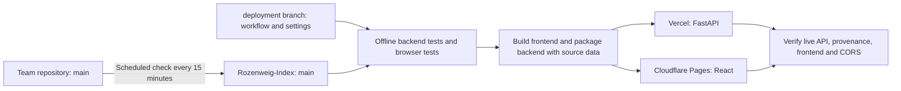

# Rozenweig-Index deployment fork

This is Ridho's fork of
[Team Aetherion's application](https://github.com/codewithaayan/Nasa-Space-Apps-Challenge-Team-Aetherion).
Its name is intentionally **Rozenweig-Index**. The fork retains the original Git history.

| Branch | Purpose |
| --- | --- |
| `main` | Application code, automatically fast-forwarded to the team's upstream `main` |
| `deployment` (default) | Deployment controls, workflow, public service settings and this guide |

Use `main` to inspect the latest application. The app files visible on `deployment`
are a snapshot from when the controls were created; the workflow always checks out
the exact mirrored `main` commit to build, test and publish.
Keep application changes in the team repository through the team's review process.
Keep hosting configuration changes on this fork's `deployment` branch.

## Normal operation

1. A reviewed change reaches upstream `main`.
2. GitHub Actions checks at minutes 7, 22, 37 and 52 each hour (UTC).
3. It fast-forwards this fork's `main`. Divergent history stops the workflow;
   there are no automatic force pushes, conflict resolutions or upstream writes.
4. If the source or deployment controls changed, the exact source revision runs
   backend pytest from `backend/` and the offline Playwright integration suite.
5. Passing code is built and uploaded as workflow artifacts. A separate job uses
   the hosting credentials to deploy the API and then the frontend.
6. Live verification checks real Karachi analysis, source fingerprints, units,
   unsupported-feature warnings, frontend links and the allowed browser origin.
7. A successful GitHub deployment record stores the source and automation SHAs.
   Unchanged successful releases are skipped. Failed releases are retried on the
   next scheduled run even if `main` was already synchronized.

The sync and deployment are in the same workflow. A push made by `GITHUB_TOKEN`
does not need to trigger a second workflow.

## Services and configuration

| Setting | Value |
| --- | --- |
| Website | https://trend-detective-aetherion.pages.dev |
| API | https://trend-detective-aetherion-api.vercel.app/api |
| Cloudflare Pages project | `trend-detective-aetherion` |
| Pages production branch | `integration` (existing host setting; independent of Git source branch) |
| Vercel project | `trend-detective-aetherion-api` in `ridhofrds-projects` |
| Public project IDs and addresses | `.github/deployment/config.json` |
| Frontend build variable | `VITE_API_BASE_URL` in the workflow; public URL, not a secret |
| Hosting CLI versions | Vercel `65.16.0`, Wrangler `4.162.0` |

Two repository Actions secrets are required:

- `VERCEL_TOKEN`: dedicated token for the `ridhofrds-projects` workspace. The
  dashboard-created token uses team scope; it can access other projects in that
  workspace. Project-scoped CLI token creation was refused by the CLI sign-in.
- `CLOUDFLARE_API_TOKEN`: Account / Cloudflare Pages / Edit, restricted to the
  account containing the existing Pages project.

These credentials are saved in GitHub's encrypted Actions secrets, never in source
or a frontend `.env`. Project IDs and public URLs can be committed. Rotate tokens
in the provider dashboard and replace the corresponding GitHub secret if expired
or revoked. Interactive CLI OAuth credentials are not copied into the workflow.
The Vercel token currently has no automatic expiry. It remains revocable in the
Vercel dashboard; account and free-plan restrictions still apply.

The API's existing Vercel environment contains `MOCK_DATA=false`, the stable Pages
origin in `ALLOWED_ORIGINS`, and the numerical-library thread settings. Provider
environment changes require another deployment to take effect.

## Run, inspect or pause

Open [Actions](https://github.com/ridhofrd/Rozenweig-Index/actions/workflows/sync-deploy.yml).
Select **Run workflow**, branch **deployment**, to sync and deploy immediately.
The force option defaults to true for a manual redeployment. Logs show the exact
source SHA and which checks or deploy step failed. To pause updates, disable the
workflow in its Actions menu; re-enable it to resume.

The fork uses GitHub Actions for both sync and deploy. The hosting projects remain
CLI-managed Direct Upload deployments; merely connecting a Git repository in a
provider dashboard is not required.

## Limits and maintenance

- A 15-minute schedule is a polling interval, not an instant push webhook or a
  maximum delay. GitHub can delay or drop scheduled runs during high load.
- GitHub disables public scheduled workflows after 60 days without repository
  activity. Re-enable the schedule in Actions when needed. See the
  [official schedule documentation](https://docs.github.com/en/actions/reference/workflows-and-actions/events-that-trigger-workflows#schedule).
- Free hosting quotas, account status and valid credentials still apply. This is
  not a promise of permanent hosting. Update the pinned CLIs/actions periodically.
- Checks finish before production changes. Vercel and Cloudflare publish in
  sequence, so the release is not atomic across both providers. If publishing or
  live verification fails, inspect logs and retry or roll back using each
  provider's deployment history. A source-contract mismatch needs a code fix;
  do not remove the failing checks just to publish it.
- The packager includes tracked `Data/` exports and optional `backend/config/`,
  but excludes local `backend/data/`, virtual environments and E2E fixtures.
  Production gridded data will need its own prepared-artifact deployment strategy
  before endpoints depending on it can become available.
- Upstream now includes Lahore, Gilgit, Islamabad, Peshawar and Quetta CSVs.
  The current CSV adapter still reads the Karachi manifest. Bundling the new
  files does not make those cities available or validate their science.
- Keep source provenance, native units and honest unavailable features. Software
  tests do not replace scientific validation.

The setup changes only Ridho's fork and the existing hosting projects. The team
repository's approval policy continues to apply to pushes, merges and PRs there.

## Setup verification (2026-11-15)

- Upstream and fork `main` matched `74669c659ab09a58d3456b9fb215e3f406e9ccb7`.
- [The first release](https://github.com/ridhofrd/Rozenweig-Index/actions/runs/43702205640)
  passed 78 backend tests, 8 browser tests, both provider deployments and live
  verification of frontend routes, real source data and CORS.
- [An unchanged follow-up run](https://github.com/ridhofrd/Rozenweig-Index/actions/runs/43702848174)
  completed successfully and skipped validation/deployment, confirming that the
  schedule does not repeatedly publish the same successful source/control pair.
- Documentation commits advance the control-branch SHA and cause one fresh
  validation/release at the next check, even when the application is unchanged.
