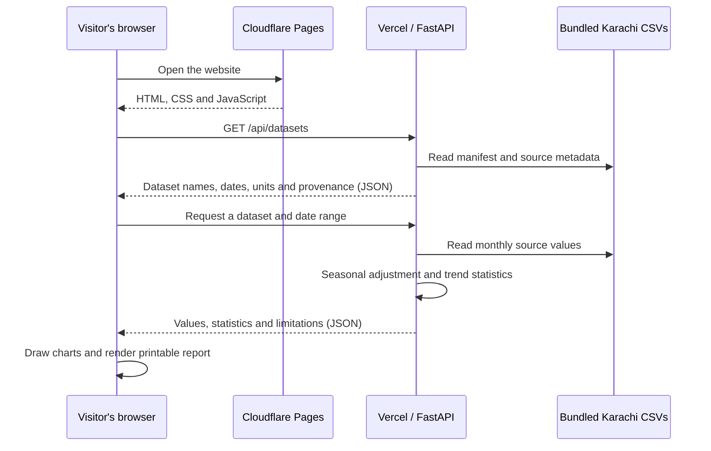

# Trend Detective deployment

The app was deployed and checked on 2026-11-15 using Cloudflare Pages and
Vercel Hobby. No payment card was added and no paid plan was selected. Both
services remain subject to their free-tier quotas.

| Resource | Verified value |
| --- | --- |
| Website | https://trend-detective-aetherion.pages.dev |
| Public API | https://trend-detective-aetherion-api.vercel.app/api |
| API health | https://trend-detective-aetherion-api.vercel.app/api/health |
| Cloudflare project | trend-detective-aetherion |
| Cloudflare deployment | 6700ca0f.trend-detective-aetherion.pages.dev |
| Vercel project / scope | trend-detective-aetherion-api / ridhofrds-projects |
| Backend deployment | dpl_AVEF6i2ahMJYE1JGCkGunEM8itKy, READY |
| Application source | 40be667f490b97ca52266c04abff0374e5ba6030 |

Use the stable website address. The generated per-deployment Cloudflare hostname
has a different browser origin and is not included in the API's allowed origins.

The source revision includes the API integration and the team's newer frontend
design. It was read from the existing remote integration branch into the isolated
checkout at work/deployment/source. Deployment adapters were added locally.
No Git push, merge or PR was performed. AGENTS.md still requires Abdullah's
approval for those actions.

## How the deployed app works



**Build:** Vite compiles React and CSS into the dist files a browser can run.
The API URL is embedded in that JavaScript at build time.

**Frontend hosting:** Cloudflare distributes those files. Python does not execute
on Pages or in the visitor's browser.

**Backend hosting:** Vercel runs the existing FastAPI app as a Python function
when requests arrive. The deployment entrypoint imports that app; it does not
reimplement statistics. The interface turns the JSON responses into charts,
maps, explanations and reports.

**Data:** The small read-only Karachi CSVs and manifest ship inside the backend
package. No database is required for the current app. Source fingerprints and
scientific limitations remain in the responses.

**CORS:** The backend tells browsers which website origins may read responses.
This is not authentication and does not block non-browser clients. The API
address is public configuration, not a secret or an API key.

## Environment files and local commands

The ignored root .env and frontend/.env both contain:

```dotenv
VITE_API_BASE_URL=https://trend-detective-aetherion-api.vercel.app/api
```

Existing unrelated settings were preserved. Never store credentials in VITE_
variables: Vite exposes those values in the browser bundle. The tracked
.env.example files document the live URL and retain /api as the default for a
local full-stack checkout.

- npm run dev: runs the interface using .env, currently the live backend.
- npm run dev:all: runs both local services and overrides the API base to /api
  for the Vite proxy.
- npm run test:e2e: explicitly builds with /api; tests stay offline even when
  .env selects the live service.

Restart Vite after editing an environment file. Rebuild and redeploy a static
frontend after changing its API address.

## Saved backend configuration

These non-secret Config values are saved in Vercel for production, preview and
development:

| Variable | Value |
| --- | --- |
| ALLOWED_ORIGINS | https://trend-detective-aetherion.pages.dev,http://localhost:5173,http://127.0.0.1:5173,http://localhost:4173,http://127.0.0.1:4173 |
| MOCK_DATA | false |
| OPENBLAS_NUM_THREADS | 1 |
| OMP_NUM_THREADS | 1 |

The deployment selects Python 3.12 and a 60-second function maximum duration.
Vercel reported a 2 GB function on the Hobby plan. DATA_ROOT and CSV_DATA_ROOT
are unset so the normal bundled paths are used. Runtime caches are disposable;
no uploads or persistent database were provisioned.

## Updating the backend

Select and verify the intended source revision first. The packaging helper
copies only backend modules, real Karachi exports, requirements, Python version
and the deployment adapter. Credentials, fixtures, virtual environments and
dependency folders are excluded.

```sh
npm run prepare:vercel -- --source work/deployment/source --output work/deployment/vercel-api-next
vercel link --cwd work/deployment/vercel-api-next --scope ridhofrds-projects --project trend-detective-aetherion-api --yes
vercel deploy --cwd work/deployment/vercel-api-next --scope ridhofrds-projects --dry --json
vercel deploy --cwd work/deployment/vercel-api-next --scope ridhofrds-projects --prod --yes --meta sourceCommit=<application-source-commit>
```

Choose a new output folder if it already exists; the helper preserves previous
deployment state. Replace the source placeholder with the actual Git revision.
Wait for READY, record the returned deployment ID and verify the public alias.
The package's deployment-source.json records the base application revision;
the local adapter files are separate from that base.

The initial package used the full declared backend requirements. Future large
grids need bundle-size, duration, memory and storage testing before they are
added to a serverless package. Do not enable E2E synthetic fixtures in production.

## Updating the frontend

Build the intended frontend revision with the actual API address:

```powershell
$env:VITE_API_BASE_URL = 'https://trend-detective-aetherion-api.vercel.app/api'
node scripts/build-cloud.mjs
```

Run the helper from the checkout containing the intended src directory. It
refuses missing, relative or localhost API addresses. For this deployment, the
helper was copied into the isolated source checkout and resolved the shared
installed Vite dependency. Application source files were preserved.

Upload the built assets to the existing project:

```sh
wrangler pages deploy <source-checkout>/dist --project-name trend-detective-aetherion --branch integration --commit-hash <application-source-commit>
```

Cloudflare's SPA fallback serves React for direct links such as /lab and /cases.
This project uses Direct Upload; automatic Git builds are not enabled. Cloudflare
documents that switching Direct Upload to Git integration requires a new project.
Wrangler updates and a custom CI workflow are supported.

Wrangler 4.162.0 initially delegated new Pages project creation to Workers.
Its direct Pages creation flag was used once after verifying that it only
selects the Pages path. The existing project uses ordinary pages deploy.

## Verification

- Backend pytest, run from backend: 72 tests.
- Browser integration suite: 8 tests. Its synthetic offline contract fixtures
  are not deployment data; the deployed catalog has only the six real exports.
- Packaged backend: real data paths, 120 selected months, native units,
  provenance, spatial limitations and explicit Cloudflare CORS.
- Live HTTP: frontend routes/assets, embedded API address, health, catalog,
  real analysis, source metadata and CORS.
- Live browser: wizard, real analysis, 120 monthly values, three chart traces,
  printable PDF, mobile layout and no unhandled page errors.
- Live preflights: Cloudflare and all four listed localhost origins.

Repeat the HTTP verification after a deployment:

```sh
npm run verify:deployment -- --frontend https://trend-detective-aetherion.pages.dev --api https://trend-detective-aetherion-api.vercel.app/api
```

Software checks do not establish scientific validation. Lahore and real regional
grids still need data. AI verdict generation and a validated future-significance
model remain unconfigured and are shown as explicit unavailable states.

## Vercel agent setup

The user-requested [setup guide](https://vercel.com/get-started.md) was followed:

- Global CLI 65.16.0 is installed and authenticated as ridhofrd.
- The official vercel/vercel-plugin is installed for Codex in user scope through
  the Codex marketplace. Standalone skills were not also installed.
- The shared MCP entry vercel points to https://mcp.vercel.com. Existing server
  entries were preserved. OAuth succeeded on retry; the CLI reports o_auth.
- The new plugin commands and MCP tools are not exposed in this already-running
  session. Reload Codex to load them, then verify documentation search and the
  authenticated list_teams MCP call. Those MCP tool calls have not yet been
  verified here. Deployment was verified through the CLI and public API.
- Approval protections were not changed. Credentials remain in supported local
  credential stores, not in source files or frontend bundles.

## Render attempt

Render CLI sign-in and selection of the user-approved My Workspace succeeded.
Render rejected Blueprint validation with need_payment_info and creation of an
explicitly free service with HTTP 402. The user chose a backend without card
verification, so deployment moved to Vercel. No Render service or paid resource
was created. render.yaml remains an optional future configuration.

## Official references

- [Vercel FastAPI](https://vercel.com/docs/frameworks/backend/fastapi)
- [Vercel Python runtime and limits](https://vercel.com/docs/functions/runtimes/python)
- [Vercel Hobby limits](https://vercel.com/docs/plans/hobby)
- [Cloudflare Direct Upload](https://developers.cloudflare.com/pages/get-started/direct-upload/)
- [Cloudflare SPA fallback](https://developers.cloudflare.com/pages/configuration/serving-pages/)
