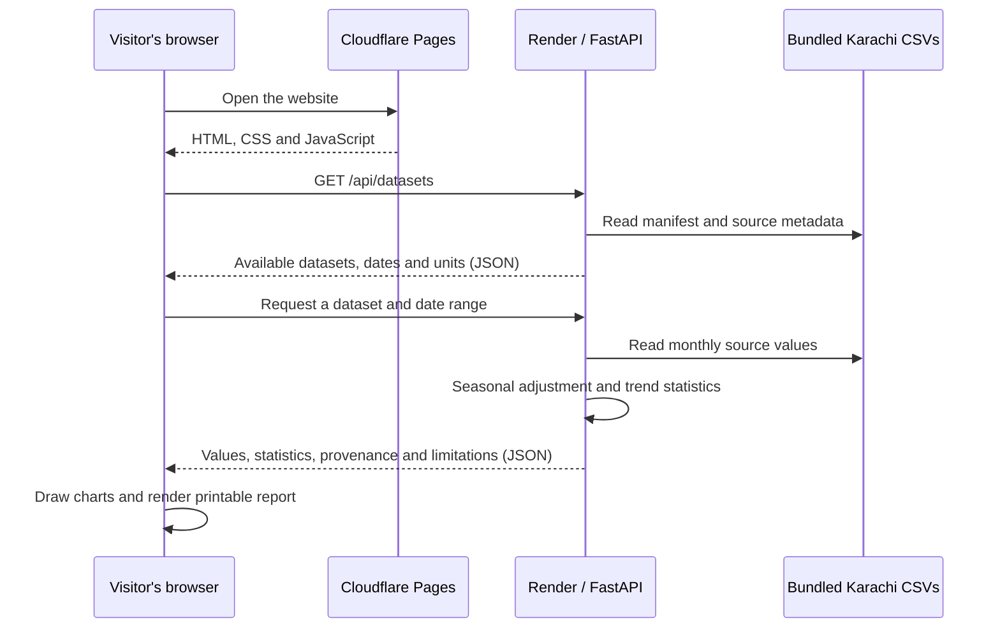

# Deploying Trend Detective

Target: Cloudflare Pages (React interface) and a free Render web service (Python
API). Configuration is prepared locally; a successful build is not proof of a
live deployment. Record actual service IDs, URLs and the deployed commit only
after the providers return them. No hosting resources have been verified yet.

On 2026-11-15, the existing remote `integration` revision was verified as
`40be667f490b97ca52266c04abff0374e5ba6030`. It includes the API integration and
newer frontend design changes. An isolated checkout at
`work/deployment/source` preserves those changes for a Direct Upload build.
Deploying that already-published source with manual Render settings requires no
new push. Local deployment helpers can be published later after approval.

## What happens when someone uses the app



The frontend is a collection of files. `npm run build:cloud` compiles React and
CSS into `dist/`; Cloudflare distributes those files. Python does not run in a
visitor's browser or on Pages. Render runs a persistent HTTP process which reads
the source exports and executes the scientific calculations. JSON is the shared
data format between the browser and API. No database is required for these
read-only source exports. The CSV files ship with the backend deployment.

The frontend API URL is public configuration, not a secret. Vite embeds it in
JavaScript at build time, so changing it requires a new frontend build. Never put
an API key into a `VITE_` variable. CORS tells browsers which website may read
responses; it does not authenticate visitors or stop non-browser API clients.

## 1. Publish an approved source revision

The repository's AGENTS.md requires Abdullah's approval before pushing, merging
or opening a PR. `render.yaml` selects the `integration` branch; confirm the
intended commit exists on the remote before asking Render to build it. A new
push is unnecessary when that source revision is already available: enter the
same service settings manually. Do not deploy an older remote branch and
describe it as the intended integration revision.
Automatic backend deployments are disabled, so later source changes do not
silently replace the demonstration. Future deployments should run checks first.

## 2. Reserve the Cloudflare Pages project

Use an existing authenticated Cloudflare account. Select Pages, not a Python
Worker. Project name: `trend-detective-aetherion`, if available; otherwise choose
a unique name and update `wrangler.jsonc`. Record the actual assigned origin.

Git integration can build the approved branch automatically. Alternatively,
Direct Upload publishes the local `dist` directory or a ZIP without a Git push.
Cloudflare says a Direct Upload project cannot later switch to Git integration;
that requires a new project. A Direct Upload project can still be updated using
Wrangler or a custom CI process. Do not publish until the real API address is
embedded and checked.

## 3. Deploy Render

The root `render.yaml` declares the free plan, Singapore region, Python runtime,
health check and single-worker process. `.python-version` selects the latest
Python 3.12 patch after that file is published. For an older published revision
without it, set `PYTHON_VERSION` to a fully qualified released Python 3.12 patch
in the Render dashboard. The backend is tested locally with Python 3.12.

| Setting | Value |
| --- | --- |
| Repository | `codewithaayan/Nasa-Space-Apps-Challenge-Team-Aetherion` |
| Branch | `integration`, after approved publication |
| Root Directory | Leave blank (repository root) |
| Runtime | Python 3 |
| Plan | Free |
| Build Command | `python -m pip install -r backend/requirements.txt` |
| Start Command | `python -m uvicorn app.main:app --app-dir backend --host 0.0.0.0 --port $PORT --workers 1` |
| Health Check | `/api/health` |
| `ALLOWED_ORIGINS` | The actual Cloudflare origin, e.g. `https://<assigned-project>.pages.dev` (no trailing slash) |
| `MOCK_DATA` | `false` |
| `OPENBLAS_NUM_THREADS`, `OMP_NUM_THREADS` | `1` each |
| Auto Deploy | Off (manual deployment of the reviewed revision) |

Keeping Root Directory blank is essential: Render excludes files outside a
configured subdirectory, and the real CSVs live at `Data/Karachi/`. `0.0.0.0`
allows Render's router to reach Uvicorn; `$PORT` is provided by Render. One worker
avoids duplicating the scientific Python imports in the free instance's memory.
Leave `DATA_ROOT` and `CSV_DATA_ROOT` unset to use the normal source paths; never
point a deployment at `work/e2e` or enable the test fixture launcher.

Wait for a successful deploy, then check `/api/health`, `/api/datasets`, and a
real dataset analysis. A healthy process alone does not prove the data shipped.
Record the actual backend URL; do not guess a service's assigned subdomain.

## 4. Build and deploy Cloudflare Pages

For Git integration, use these settings at the repository root:

| Setting | Value |
| --- | --- |
| Production Branch | The approved `integration` branch |
| Build Command | `npm run build:cloud` |
| Build Output Directory | `dist` |
| `VITE_API_BASE_URL` | `https://<actual-render-host>/api` |

For a local Direct Upload build, in PowerShell:

```powershell
$env:VITE_API_BASE_URL = 'https://<actual-render-host>/api'
npm run build:cloud
```

Upload only `dist`, not the repository, `.env`, `.git` or backend. The guarded
cloud build refuses a missing, relative or localhost API address. The ordinary
`npm run build` still supports local same-origin hosting. Cloudflare provides
SPA fallback when there is no top-level `404.html`, so refreshing `/lab` or
`/cases` loads React rather than returning a missing-file error.

If using an authenticated Wrangler CLI (installed from the official npm registry):

```sh
npx wrangler pages project create trend-detective-aetherion --production-branch integration
npx wrangler pages deploy dist --project-name trend-detective-aetherion --branch integration
```

Use the existing project instead of creating it again. The user handles account
login and any grant of new account permissions. Keep credentials out of tracked
files, command arguments and screenshots. `wrangler.jsonc` contains no credentials.

## 5. Verify the live pair

```sh
npm run verify:deployment -- --frontend https://<actual-project>.pages.dev --api https://<actual-render-host>/api
```

This checks API JSON, all six real source datasets, 120 selected precipitation
months, native units and source fingerprints, explicit allowed-origin CORS,
rejection of an unrelated origin, direct SPA URLs, JavaScript assets and the
API URL embedded in the frontend bundle. It refuses synthetic fixture catalogs.
Follow with a browser check of the wizard, analysis, printing and mobile layout.
Do not claim a deployment passed browser checks if only HTTP checks were run.

## Free-tier and science limits

Render's free service sleeps after 15 idle minutes and may take about a minute
to wake. The current UI permits a retry; a cold backend can exceed its 60-second
request timeout. Free compute has 512 MB RAM and no persistent disk. Source files
included in each build remain available; runtime caches are disposable. Keep
future large grids out of the free instance until memory and request duration
are measured. Hosting does not provide an always-on service guarantee.

Do not use synthetic demonstration fixtures as deployment data. Karachi source
provenance, native units, missing spatial information and unreviewed scientific
status remain visible. Lahore and regional grids still require real sources;
AI verdict generation and a validated years-to-significance model are not
configured by hosting the app.

## Official references

- [Render FastAPI deployment](https://render.com/docs/deploy-fastapi)
- [Render monorepo root directories](https://render.com/docs/monorepo-support)
- [Render Python version selection](https://render.com/docs/python-version)
- [Render free-tier limits](https://render.com/docs/free)
- [Cloudflare React build settings](https://developers.cloudflare.com/pages/framework-guides/deploy-a-react-site/)
- [Cloudflare Direct Upload](https://developers.cloudflare.com/pages/get-started/direct-upload/)
- [Cloudflare SPA fallback](https://developers.cloudflare.com/pages/configuration/serving-pages/)
